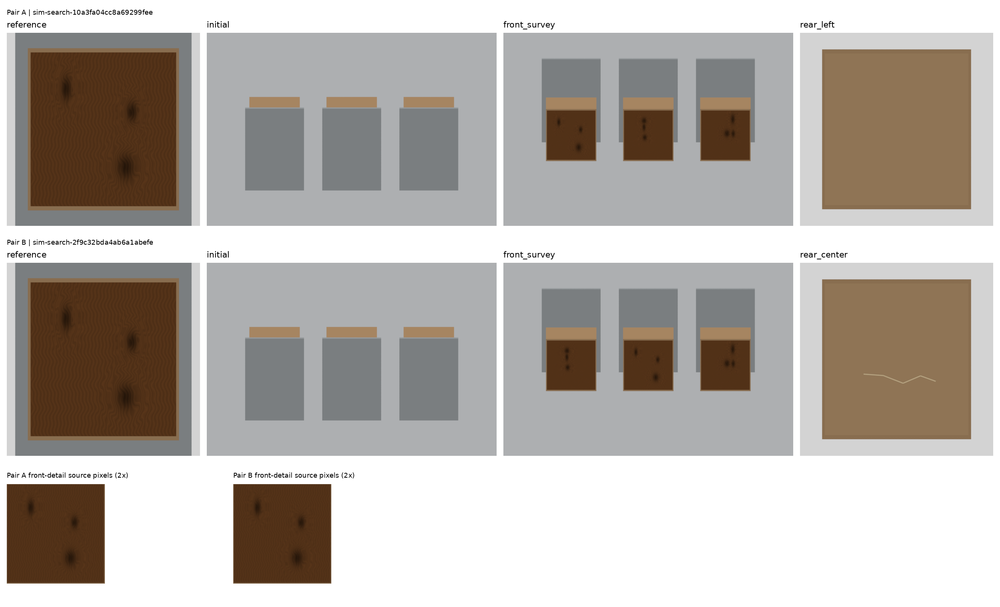

# 两步搜证：先定位，再检查

[下载完整案例包（约36 MB）](https://github.com/ZhangAIPI/ResolveAI/releases/tag/multistep-search-v0.1) · [SHA-256及528版本验证记录](https://github.com/ZhangAIPI/ResolveAI/releases/tag/multistep-search-v0.1)

这组受控仿真案例补充原有公共照片评测。原题主要恢复被隐藏的原图；新题要求先认出目标的位置，再请求该位置的背面照片。

题目示例：**“参考照片中的木箱，在检查时背面有划痕吗？”**

图中两案具有相同的参考图和初始图。第一张新照片显示三个木箱的正面，目标靠自然木纹和结疤区分；两案的目标分别在左侧和中间。第二步应分别请求左侧和中间木箱的背面。请求始终只释放已经记录的照片，不改变物品状态。前后照片的对应依据是同次检查中固定的位置，不能据此宣称已验证自然场景中的跨视角重识别。

## 为什么一次恢复原图不够

初始图遮住正面纹理与背面状态。`original` 返回相同相机已有分辨率，新增像素不能揭开遮挡。前视图能确定目标位置，但看不到背面；任一背面细节图能显示该位置的状态，却不能单独确定它是不是参考物体。

每个场景枚举 6 种身份排列与 8 种背面状态，共 48 个可能世界。检查公开像素与元数据后，所有零步／一步观察仍兼容正负两个答案；前视图加匹配位置的背面图则确定答案。另做实际复渲染检查，排除隐藏身份或状态经阴影、反射等泄漏。有限世界证书证明的是这组构造的信息关系，不能替代独立人工充分性审核。

## 比较哪些策略

所有策略最多请求两次照片，使用相同公开请求选项与最终回答设置。请求重复照片也占一次。

| 策略 | 第一、第二次请求 | 用途 |
|---|---|---|
| Adaptive | 模型依次选择；第二步可以读取第一步返回的照片 | 测试依观察选图 |
| Fixed restoration | 原图 → 原图 | 检查恢复细节能否解决新题 |
| Fixed view order | 前视 → 左侧背面 | 与有用但不依观察改变的规则比较 |
| Random | 从五个公开选项随机取两个，不重复 | 随机搜证参考 |
| Oracle | 前视 → 正确位置的背面 | 使用隐藏位置的请求参考，单独报告 |

超过原图恢复并不足以证明自适应搜索；还要与固定视图顺序和随机请求比较，并检查配对案件中的第二步是否随目标位置改变。统计按共享场景成组计算置信区间。

## 分开检查找到、看懂和提交

- **找到证据**：实际返回的照片是否已排除答案相反的可能世界。
- **答案正确**：最终答案是否符合该场景状态；猜对也可能属于这一项。
- **证据链正确**：答案正确，引用已看到的图片，明确对应同一物体，并覆盖实际可见的诊断区域。
- **区域定位正确**：在证据链正确之外，引用框还需准确覆盖缺陷或完整背板。宽松的大框与精确定位分开计分。
- **成功提交**：格式合法并结束；单独统计，避免把格式失败都当成视觉错误。

评分使用渲染身份、真实第一可见表面 mask 与完整反事实池，不把模型描述当真值。自动区域候选及选择题形式的诊断另列；其候选框与自动连接帮助不算模型自主 grounding。

## 数据与划分

完整冻结包含种子71000–71065的66场景、132案件族、528个访问版本；正负各66，三个目标位置各44。本轮两请求实验只测每族的Obtainable版本。共享场景的两个案件必须留在同一划分和bootstrap组内。[冻结清单](../datasets/multistep_search_manifest.json)保留全部种子、文件校验和构建／评分源码指纹。

原生接口试跑使用首批8场景、16案。RGB程序也只用这部分开发，冻结后才测试其余58场景、116案。全量132案、留出116案与16案pilot的分母不能混用。

## 已完成结果：不要混用三种接口

### RGB程序的116案留出测试

首批8场景、16案只用于开发程序；剩余58场景、116案用于冻结后的测试。程序通过公开RGB的木纹相关性选择位置，再从背面图检测亮色划痕并给出框。每个策略都在真实Environment中请求两次，最后共用同一个RGB判断程序；mask和隐藏身份不进入选图或画框算法。

| 两次请求策略 | 严格程序grounded正确 | 找到充分证据 |
|---|---:|---:|
| 正面→根据木纹选择背面 | **106/116（91.4%）** | 106/116 |
| 原图→原图 | 0/116 | 0/116 |
| 正面→固定左侧背面 | 34/116（29.3%） | 38/116 |
| 随机两个不同视图 | 11/116（9.5%） | 12/116 |
| 特权选择目标背面＋相同RGB判断 | 106/116（91.4%） | 116/116 |

58个配对场景bootstrap（10,000次）得到：自适应减固定顺序为+62.1个百分点，95%区间[54.3,69.8]；减随机为+81.9，[73.3,89.7]。程序在自适应组有6次不确定匹配而弃答、4次错误身份匹配，均保留在分母；106次身份匹配正确时，判断和定位也通过了严格检查。算法冻结后未按留出集结果改阈值。

这个程序使用了该renderer的颜色、相机和纹理特点；第一步还是人为固定的正面视图。因此它只确认这组场景可通过观察决定第二步解决，既不是MLLM成绩，也不是学得策略或真实照片泛化的证据。特权组也使用同一RGB判断程序，不能称为完美读图上限。[程序结果、冻结指纹与完整性检查](../results/multistep_search_program_heldout.json)

### 原生工具调用的16案试跑

四条Qwen3-VL-8B路线各完成80次运行（16案×五策略），不是把未测题当零分。自主选择的结果如下：

| 路线 | 找到证据 | 合法最终提交 | 严格程序grounded正确 | 配对场景正确切换第二步 |
|---|---:|---:|---:|---:|
| Base | 6/16 | 0/16 | 0/16 | 0/8 |
| SFT | 0/16 | 16/16 | 0/16 | 0/8 |
| RL | 3/16 | 2/16 | 0/16 | 0/8 |
| SFT+RL | 0/16 | 16/16 | 0/16 | 0/8 |

Base的第二请求始终为左侧背面，和固定顺序一样；它在需要结束时继续调用其他工具，没有产生合法最终答案。SFT和SFT+RL均先要中间背面，再尝试finish，未取得正面身份信息。这些是不同问题：未正确结束、未找到证据、以及已经提交却缺少有效证据链，不能统一写成“模型看错”。

在特权选图组，SFT和SFT+RL各提交15/16次，来源标签正确11/16和12/16，但完整定位身份链均为0。Base和RL在该组均未完成最终提交。这一小规模原生pilot尚未显示自适应优势，也不足以推断post-training普遍损害搜证能力。[所有五策略、格式失败、答案与配对行为](../results/multistep_search_native_pilot.json)

### 完整四策略选择题诊断

界面提供RGB候选框、自动连接和有限答案选项，用于分离原生提交负担；它不测模型自主画框或生成连接。四模型策略各完成132案×五请求策略（660次），共2,640次。下面先核验原始全量，再排除同一批16开发案，统一使用116案／58场景：

| 模型策略 | 自适应找到证据 | 固定前视→左背找到证据 | 自适应标签正确 | 特权选图标签正确 | 配对两题都找到证据 |
|---|---:|---:|---:|---:|---:|
| 8B Base | 40/116 | 38/116 | 0/116 | 0/116 | 1/58 |
| 8B SFT+RL | 2/116 | 38/116 | 4/116 | 7/116 | 0/58 |
| Qwen3.5-9B | 6/116 | 38/116 | 17/116 | 58/116 | 0/58 |
| InternVL3.5-8B | 35/116 | 38/116 | 0/116 | 2/116 | 0/58 |

五种请求策略均有116/116次有效选择和最终提交，零分不来自解析器未结束。Base自适应相对固定顺序的证据率差为+1.7个百分点，场景配对95% CI [0,4.3]；其余三策略分别为−31.0 [−37.1,−25.0]、−27.6 [−34.5,−19.8]、−2.6 [−6.0,0]。结果尚未显示学习策略在新程序题上有稳定自适应优势。

[全量132案分析](../results/multistep_search_assisted_full.json)与[同一116案留出分析](../results/multistep_search_assisted_heldout.json)包含全部五请求策略、配对区间、图像与运行哈希。不能把这些分数与原生接口或RGB程序合并排名。已有适配器未接受程序题训练。

[固定样例接口审计](../results/multistep_search_choice_interface_audit.json)核验了8条原始记录的实际prompt SHA、图片块、CPU processor输入token和选项映射，未发现漏图、上下文截断或错映射。答案顺序仍固定，“需要更多证据”始终为A，因此有限选择低分可能包含位置偏好或接口不适配；受限logits也不是校准置信度。原生接口下12/16标签正确但证据链仍失败，进一步说明“答对标签”“正确引用”和“选择有效”需要分开。

## 复现入口

- 构建与冻结：`scripts/build_multistep_cases.py`。
- 原生接口：`scripts/evaluate_multistep.py`；完整结果分析：`scripts/analyze_multistep.py`。
- 界面辅助：`scripts/evaluate_multistep_choice.py`。
- renderer专用RGB程序：`scripts/evaluate_multistep_sanity.py`；五项针对性测试覆盖可见纹理变化、像素划痕框、弃答和隐藏元数据隔离。其留出集执行要求已完成的pilot代码指纹一致。

这组简化程序场景主要检验“先匹配位置，再检查状态”的机制，不增加真实业务数据，也不改变原有公共照片结果的标注性质。
